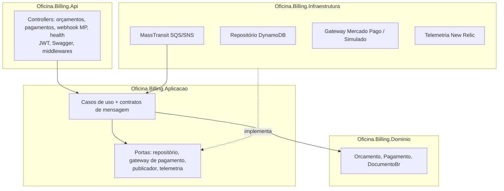
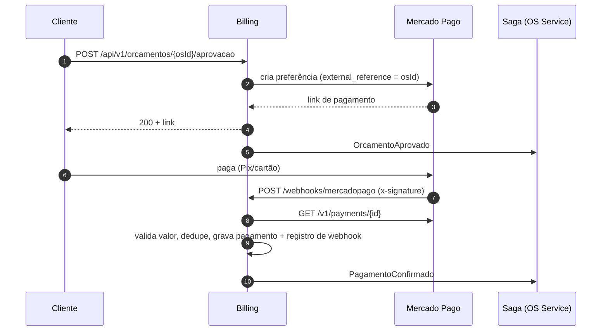
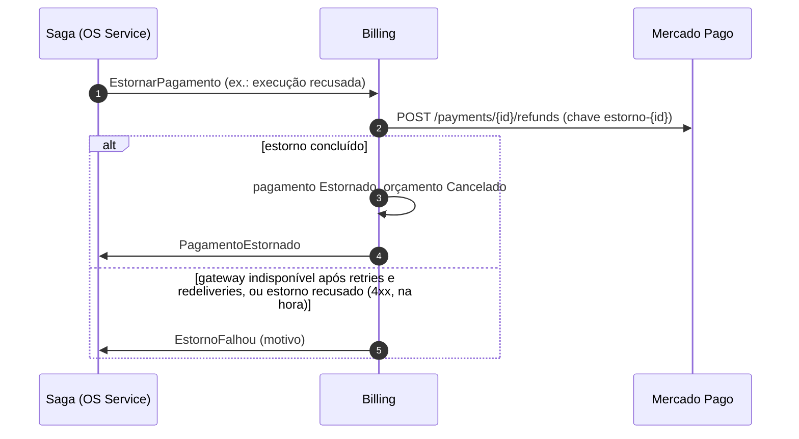

# Oficina Billing Service

[](https://github.com/lcr-thiago-fernandes/oficina-billing-service/actions/workflows/ci.yml)

Microsserviço de **orçamento e pagamento** da oficina (FIAP 15SOAT, Fase 4): gera o orçamento da OS, cobra via
Mercado Pago (Checkout Pro), processa o webhook de pagamento e estorna quando a saga manda compensar. .NET 8
(Clean Architecture), DynamoDB, SQS/SNS (MassTransit), JWT, New Relic.

## Papel na Saga

Participante da saga **orquestrada** da OS (o orquestrador fica no OS Service, `oficina-app`; o Billing só recebe
comandos e publica o desfecho). Design completo:
[fase4-design-arquitetural.md](https://github.com/lcr-thiago-fernandes/oficina-app/blob/develop/docs/arquitetura/fase4-design-arquitetural.md).
Detalhes deste serviço (C4, máquinas de estado, algoritmo do webhook, falhas e compensação):
[`docs/arquitetura/billing-service.md`](docs/arquitetura/billing-service.md).

| Direção | Mensagem (URN `oficina:saga:<Nome>`) | Fila / tópico |
|---|---|---|
| Consome | `GerarOrcamento` | fila `{prefixo}-oficina-billing-comandos` |
| Consome | `CancelarOrcamento` | fila `{prefixo}-oficina-billing-comandos` |
| Consome | `EstornarPagamento` | fila `{prefixo}-oficina-billing-comandos` |
| Publica | `OrcamentoGerado` / `OrcamentoFalhou` | tópicos `{prefixo}-oficina-saga-<Nome>` |
| Publica | `OrcamentoAprovado` / `OrcamentoRejeitado` | tópicos `{prefixo}-oficina-saga-<Nome>` |
| Publica | `PagamentoConfirmado` / `PagamentoRecusado` | tópicos `{prefixo}-oficina-saga-<Nome>` |
| Publica | `PagamentoEstornado` / `EstornoFalhou` | tópicos `{prefixo}-oficina-saga-<Nome>` |

`{prefixo}` ∈ `local | hml | prd`. Contratos JSON e `SHA256SUMS` em [`docs/contratos/mensagens/`](docs/contratos/mensagens),
verificados por testes de contrato. Pontos de contrato entre repositórios: [`docs/contratos-entre-repositorios.md`](docs/contratos-entre-repositorios.md).

## Arquitetura



### Aprovação → webhook → `PagamentoConfirmado`



### Compensação: estorno



## API

JWT (HS256, `iss=oficina-auth`, `aud=oficina-api`). Via API Gateway o prefixo é `/billing`.

| Método | Rota | Descrição | Respostas |
|---|---|---|---|
| GET | `/billing/api/v1/orcamentos/{osId}` | Consulta o orçamento | 200, 404 |
| POST | `/billing/api/v1/orcamentos/{osId}/aprovacao` | Aprova e devolve o link de pagamento (idempotente) | 200, 404, 409, 502 (Mercado Pago indisponível) |
| POST | `/billing/api/v1/orcamentos/{osId}/rejeicao` | Rejeita o orçamento | 200, 404, 409 |
| GET | `/billing/api/v1/pagamentos/{osId}` | Lista os pagamentos da OS | 200, 404 |
| POST | `/billing/webhooks/mercadopago` | Webhook do Mercado Pago (anônimo, valida `x-signature`) | 200, 400, 401, 500 (falha transitória: gateway fora ou conflito de concorrência; o MP reenvia) |
| POST | `/billing/api/v1/simulador/pagamentos/{osId}` | Só no modo `Simulado`, perfil Admin: registra pagamento `aprovado`/`recusado` | 200, 400, 404, 409 |
| GET | `/billing/health` | Saúde (anônimo) | 200 |
| GET | `/billing/swagger` | Swagger UI (anônimo); JSON em `/billing/swagger/v1/swagger.json` | 200 |

Perfil **Cliente** só acessa o que é seu (o `documento` do token tem de casar com o do orçamento; não-dono
recebe 404, Cliente sem `documento` recebe 403); Atendente e Admin acessam tudo. Sem token: 401; perfil sem
permissão para a rota (ex.: simulador fora de Admin): 403. Em qualquer rota, o middleware de exceções devolve
`application/problem+json`: 422 para regra de domínio violada, 409 para conflito de concorrência, 502 para Mercado
Pago indisponível e 500 para erro inesperado.
Roteiro de chamadas: [`http/billing.http`](http/billing.http).

## Por que DynamoDB e por que não há outbox

Banco por serviço: o acesso é por chave (`OS#<osId>`), sem joins, e a única atomicidade necessária é dentro de uma
OS (`TransactWriteItems`, com condição de versão). DynamoDB e SQS/SNS não compartilham transação; em vez de uma
tabela outbox, o serviço **grava antes de publicar** e todo comando/webhook é idempotente: uma reentrega republica
o resultado já gravado (spec §4.2). O custo é a entrega at-least-once, tolerada pelos consumidores da saga.

### Modelo de itens (tabela única `pk`/`sk`)

| `pk` | `sk` | Conteúdo |
|---|---|---|
| `OS#{osId}` | `ORCAMENTO` | Orçamento: cliente, itens, valor total, status, motivo, preferência/link, `versao` |
| `OS#{osId}` | `PAGAMENTO#{paymentId}` | Pagamento: valor, meio, status, detalhe, `estornoId`, `versao` |
| `WEBHOOK#{paymentId}` | `WEBHOOK` | Dedupe do webhook: evento decidido, `eventoPublicado`, `expiraEm` (TTL) |

## Configuração

Variáveis de ambiente no padrão `Secao__Chave` (ou `appsettings.json`).

| Chave | Padrão | Descrição |
|---|---|---|
| `Jwt__Secret` | (vazio, obrigatório) | Segredo HS256, o mesmo de `oficina/jwt_secret` |
| `Jwt__Issuer` / `Jwt__Audience` | `oficina-auth` / `oficina-api` | Emissor e audiência esperados |
| `Mensageria__Transporte` | `InMemory` (compose/K8s: `AmazonSqs`) | `AmazonSqs` ou `InMemory` |
| `Mensageria__PrefixoAmbiente` | `local` | Prefixo de filas/tópicos |
| `Mensageria__Regiao` / `Mensageria__ServiceUrl` | `us-east-1` / vazio | Região; endpoint alternativo (LocalStack) |
| `Dynamo__NomeTabela` | `oficina-billing-local` | Tabela |
| `Dynamo__ServiceUrl` / `Dynamo__CriarTabelaSeAusente` | vazio / `false` | DynamoDB Local; só para dev (em hml/prd o Terraform cria) |
| `Pagamento__Modo` | `Simulado` | `MercadoPago` ou `Simulado` |
| `Pagamento__SimularFalhaEstorno` | `false` | Faz todo estorno do gateway simulado falhar (demo de compensação) |
| `MercadoPago__AccessToken` / `MercadoPago__WebhookSecret` | vazio | Credenciais (segredos) |
| `MercadoPago__UrlNotificacao` | vazio | `notification_url` enviada ao criar a cobrança |
| `NEW_RELIC_APP_NAME` | `oficina-billing` | Nome no New Relic |

## Como rodar

```bash
cp .env.example .env            # defina JWT_SECRET
docker compose --env-file .env -f docker/docker-compose.yml up -d --build --wait
./scripts/gerar-token-dev.sh Atendente      # JWT de desenvolvimento (ou Admin; lê o .env)
./scripts/enviar-gerar-orcamento.sh <osId>  # envia GerarOrcamento para a fila local
```

API em `http://localhost:8082/billing` (Swagger em `/billing/swagger`), roteiro em
[`http/billing.http`](http/billing.http). Em modo `Simulado`, um Admin usa
`POST /billing/api/v1/simulador/pagamentos/{osId}` no lugar do checkout.

### Modo Simulado e demo de falha de estorno

`Pagamento__Modo=Simulado` troca o Mercado Pago por um gateway em memória (sem rede nem credenciais). Regras: hml é
sempre `Simulado`; prd usa `MercadoPago`, mas cai para `Simulado` com aviso enquanto o segredo do Mercado Pago for o
placeholder do Terraform. O gateway simulado não guarda estado entre pods: o id do pagamento
(`sim-{a|r}-{osId}-{valor}-{nonce}`) carrega o resultado, a OS e o valor, então qualquer réplica consulta e estorna
um pagamento emitido por outra, e ids nunca se repetem após um redeploy. Para demonstrar a compensação, suba com
`Pagamento__SimularFalhaEstorno=true`: todo estorno falha como indisponibilidade e o serviço publica `EstornoFalhou`
depois de esgotar os retries (3 imediatos por entrega) e, no SQS, os 3 redeliveries atrasados (1, 5 e 15 min); com
`Mensageria__Transporte=InMemory` não há redelivery, então basta esgotar os retries. Se o gateway **recusar** o
estorno (4xx do Mercado Pago, que não adianta repetir), `EstornoFalhou` é publicado na hora, sem novas tentativas.

## Configuração do Mercado Pago

1. Em [mercadopago.com.br/developers](https://www.mercadopago.com.br/developers) crie uma **aplicação** (Checkout Pro).
2. Em *Credenciais de teste*, copie o **Access Token** de teste; crie dois **usuários de teste** (vendedor e comprador)
   para pagar sem dinheiro real.
3. Em *Suas integrações → Webhooks*, configure a URL do webhook,
   `https://<api-id>.execute-api.us-east-1.amazonaws.com/billing/webhooks/mercadopago` (é o valor do parâmetro SSM
   `/oficina/billing/url_notificacao_mercadopago`), com o evento **Pagamentos**.
4. Copie a **assinatura secreta** do webhook e grave os dois segredos:

```bash
aws secretsmanager put-secret-value --secret-id oficina/billing/mercadopago_access_token  --secret-string "<access token>"
aws secretsmanager put-secret-value --secret-id oficina/billing/mercadopago_webhook_secret --secret-string "<assinatura secreta>"
```

5. **Reexecute o CD** (`cd.yml`, branch `main`): ele lê os segredos, recria o Secret do K8s e sobe prd com
   `Pagamento__Modo=MercadoPago`. O webhook só é aceito com `x-signature` válida: HMAC-SHA256, com a assinatura secreta, do manifesto
   `id:<data.id em minúsculas>;request-id:<x-request-id>;ts:<ts>;` (os pares `id` e `request-id` ausentes são
   omitidos do manifesto).

## Testes

```bash
dotnet test OficinaBilling.sln
```

**Docker é obrigatório** para os testes de integração e BDD (Testcontainers com DynamoDB Local 2.5.2 e LocalStack
3.8.1). Projetos em `tests/`: `Dominio.Testes` (unidade), `Aplicacao.Testes` (casos de uso e contratos de mensagem),
`Infraestrutura.Testes` (integração: DynamoDB e SQS/SNS reais em contêiner), `Api.Testes` (HTTP, JWT, webhook,
Swagger) e `Bdd.Testes` (Gherkin em português).

### Evidência de cobertura

Gate do CI: cobertura de linhas **>= 80%**. Medido localmente com o mesmo comando do `ci.yml`
(308 testes, 0 falhas), consolidado com ReportGenerator 5.5.11:

| Projeto | Linhas | Branches |
|---|---|---|
| `Oficina.Billing.Dominio` | 100% | 100% |
| `Oficina.Billing.Aplicacao` | 99,3% | 97,0% |
| `Oficina.Billing.Infraestrutura` | 96,5% | 89,7% |
| `Oficina.Billing.Api` | 93,0% | 75,8% |
| **Total** | **96,9%** (1.176 de 1.213 linhas) | **90,5%** (404 de 446) |

Saída completa: [`docs/evidencias/cobertura-Summary.txt`](docs/evidencias/cobertura-Summary.txt). O relatório HTML é
publicado a cada execução do CI como artefato `coverage-report`
([execuções do CI](https://github.com/lcr-thiago-fernandes/oficina-billing-service/actions/workflows/ci.yml)).

## CI/CD e qualidade

- CI ([`ci.yml`](.github/workflows/ci.yml)): `build-test` (com gate de 80%), `docker-build`, `codeql`, `format` (advisory) e `sonar`.
- Qualidade de código (job `sonar`), em dois modos:
  - **Sem `SONAR_TOKEN` (situação atual, não há conta SonarCloud):** o job sobe um SonarQube Community **efêmero** como service container (`sonarqube:26.10.0.133078-community`), troca a senha padrão do admin por uma aleatória, gera um token, cria o projeto e roda `dotnet-sonarscanner` com cobertura OpenCover e resultados de teste (trx). Depois consulta o quality gate (o job **falha** se o status for `ERROR`) e publica cobertura, bugs, vulnerabilidades, code smells e duplicação no **resumo da execução do CI** (aba *Summary* do job `sonar`) e no artefato `sonar-summary`. O servidor é descartado ao fim do job: não há dashboard persistente, a evidência é o resumo/artefato de cada execução. Exemplo: [execução 44071898261](https://github.com/lcr-thiago-fernandes/oficina-billing-service/actions/runs/44071898261): quality gate `OK`, cobertura 93,1%, 0 bugs, 0 vulnerabilidades, 0 hotspots, 11 code smells, 0% de duplicação, ratings A/A/A, 2.278 linhas de código.
  - **Com `SONAR_TOKEN` (secret) e `SONAR_ORGANIZATION` (variável):** a análise vai para o SonarCloud (`sonar.qualitygate.wait=true`), projeto `<owner>_<repositório>`.
- CD ([`cd.yml`](.github/workflows/cd.yml)): imagem no ECR e deploy em `oficina-hml` (develop) e `oficina-prd` (main); pula o deploy com aviso enquanto o secret `AWS_DEPLOY_ROLE_ARN` não existir. Manifestos em [`k8s/`](k8s/README.md). O repositório ECR é `MUTABLE` (igual ao `oficina-execucao-service`): a tag é o SHA do commit, então reexecutar o CD no mesmo commit sobrescreve a tag em vez de falhar no `docker push`; nesse caso o CD faz `rollout restart` para os pods lerem o Secret/ConfigMap atualizados.
- Infra própria em [`terraform/`](terraform) (`infra.yml`): ECR, DynamoDB, IRSA, segredos do Mercado Pago, NLB (8081 prd, 8082 hml) e rotas `/billing` no API Gateway. **Desvio consciente da spec §8 (D13):** `infra.yml` roda `validar` (fmt/validate, sem AWS) em PR e `plan` só no push, porque a trust da role `oficina-gha-infra` aceita apenas `main`/`develop`.
- Branches `main` e `develop` protegidas (PR, 1 aprovação, checks `build-test`, `docker-build`, `codeql` e `sonar`, sem force push): [`scripts/setup-branch-protection.sh`](scripts/setup-branch-protection.sh).

## Decisões (D1 a D13)

| # | Decisão |
|---|---|
| D1 | Prefixo de ambiente por tipo de mensagem com `SetEntityName` (spec §5). |
| D2 | Portas 30082/8081 (prd) e 30083/8082 (hml). |
| D3 | Não-dono recebe 404 (não revela existência); Cliente sem `documento` recebe 403. |
| D4 | Sem janela de tempo no `ts` do webhook; o dedupe por `payment_id` cobre replay. |
| D5 | hml sempre `Simulado`; prd cai para `Simulado` com aviso enquanto o segredo MP for placeholder. |
| D6 | Segredos chegam ao pod pelo Secret do K8s criado no CD; o IRSA não tem `secretsmanager`. |
| D7 | Só prd integra com o API Gateway. |
| D8 | Rotas públicas extras `GET /billing/health` e `GET /billing/swagger/{proxy+}`. |
| D9 | `GET /api/v1/pagamentos/{osId}` com a mesma autorização do orçamento. |
| D10 | Pagamento aprovado inaceitável (orçamento cancelado/valor divergente) gera estorno automático; `EstornarPagamento` concluído também cancela o orçamento. |
| D11 | Dedupe de webhook só para status terminais (`approved`/`rejected`/`cancelled`); `pending` não cria registro. |
| D12 | Role de deploy `oficina-gha-deploy-billing` criada no `terraform/`. Ordem: `apply` manual (`workflow_dispatch` em `main`), depois `gh secret set AWS_DEPLOY_ROLE_ARN` com o valor de `/oficina/billing/deploy_role_arn`, só então o primeiro CD. |
| D13 | `infra.yml`: `validar` em PR e `plan` no push (ver acima). |
