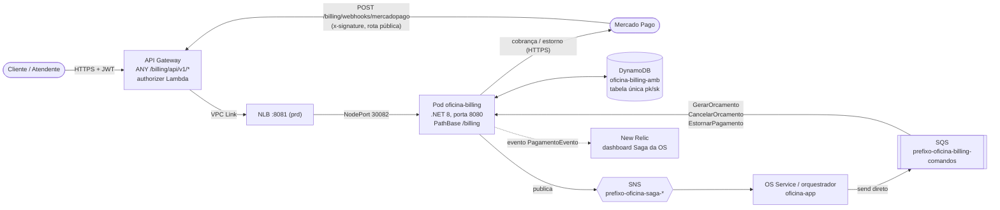
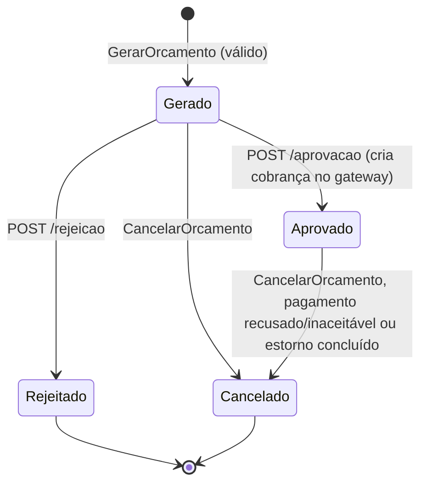
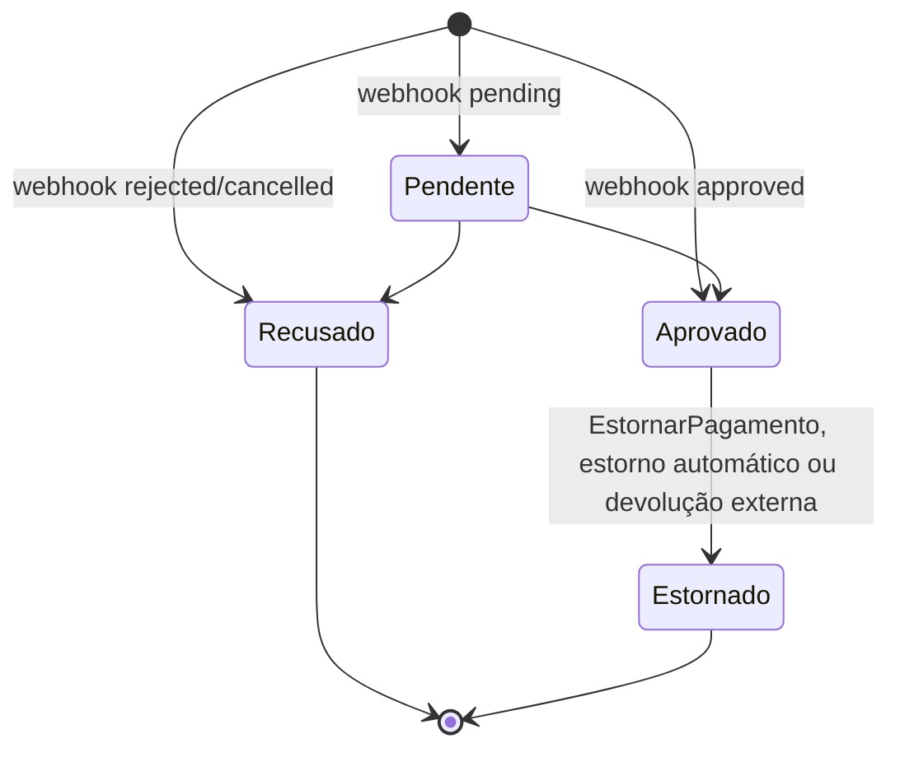

# Arquitetura do Billing Service

Serviço de **orçamento e pagamento** da oficina (FIAP 15SOAT, Fase 4). Participante da saga **orquestrada** da
Ordem de Serviço: o orquestrador fica no OS Service (`oficina-app`); o Billing recebe comandos, executa sua parte
(gerar/cancelar orçamento, cobrar via Mercado Pago, estornar) e publica o desfecho. Design completo e justificativas
(banco por serviço, saga, mensageria): [fase4-design-arquitetural.md](https://github.com/lcr-thiago-fernandes/oficina-app/blob/develop/docs/arquitetura/fase4-design-arquitetural.md).

## C4 nível 2 (contêineres)

Camadas (`src/`): `Dominio` (agregados `Orcamento` e `Pagamento`, sem dependências) → `Aplicacao` (casos de uso,
contratos de mensagem e portas `IRepositorioBilling`, `IGatewayPagamento`, `IPublicadorMensagens`,
`ITelemetriaPagamento`) → `Infraestrutura` (DynamoDB, MassTransit/SQS+SNS, Mercado Pago e gateway simulado,
New Relic) → `Api` (controllers, JWT, Swagger, webhook).

## Máquinas de estado

### Orçamento

`Aprovado` também é o estado final de um orçamento pago (o pagamento confirmado não muda o orçamento). `Aprovar` e
`Rejeitar` só valem em `Gerado` (outro estado responde 409). `Cancelar` é idempotente: em estado terminal
(`Cancelado`/`Rejeitado`) não altera nada.

### Pagamento

## Algoritmo de notificação de pagamento

`ProcessarNotificacaoPagamentoCasoDeUso` roda a cada webhook válido do Mercado Pago. O webhook só traz o `id` do
pagamento; a decisão usa o estado real consultado no gateway.

1. **Consulta o pagamento no gateway** e descobre a OS (`external_reference`). Sem pagamento, sem OS ou sem
   orçamento: ignora (log de aviso, HTTP 200 para não gerar reentrega).
2. **Dedupe por `payment_id`.** Se já existe `RegistroWebhook` do pagamento, é duplicado: se o evento daquela
   decisão ainda não foi marcado como publicado (queda entre gravar e publicar), **republica** o mesmo evento; senão
   não faz nada. Essa checagem vem antes de qualquer regra sobre o status do gateway.
3. **`pending`**: só registra o pagamento como `Pendente` (sem registro de dedupe, para que o desfecho real seja
   processado depois).
4. **Desfecho** (`approved`, `rejected`, `cancelled`, `refunded`):
   - Aprovado, orçamento `Aprovado`, valor igual ao total e nenhum outro pagamento aprovado da OS: evento
     **`PagamentoConfirmado`**. O orçamento entra na transação só pela condição de versão, de modo que dois
     pagamentos aprovados simultâneos da mesma OS não confirmam os dois.
   - Aprovado, mas inaceitável (orçamento cancelado, valor divergente, outro pagamento já aprovado): **estorno
     automático** com chave idempotente `estorno-{pagamentoId}`; se a OS ainda aguardava pagamento, o orçamento é
     cancelado e sai **`PagamentoRecusado`** (`valor_divergente` ou `pagamento_estornado`). Se o gateway recusa o
     estorno (4xx) e o pagamento não consta devolvido, o pagamento fica `Aprovado` (pendência manual), a
     telemetria registra `EstornoAutomatico`/`Falha` e a saga ainda recebe o desfecho.
   - Recusado (`rejected`/`cancelled`): se a OS aguardava pagamento, orçamento `Cancelado` com o detalhe do
     gateway como motivo e **`PagamentoRecusado`**; caso contrário nenhum evento.
5. **Grava atomicamente** (transação DynamoDB) pagamento + `RegistroWebhook` (+ orçamento). Se outra réplica gravou
   primeiro, trata como duplicado (passo 2).
6. **Publica o evento e marca o registro como publicado.** Entrega at-least-once: o consumidor da saga é idempotente.

## Falhas e compensação (visão do Billing)

Linhas 2, 3, 4 e 6 da tabela de falhas da spec §4.2 (saga orquestrada pelo OS Service), mais as falhas internas
do próprio Billing.

| Falha | O que o Billing faz | Compensação |
|---|---|---|
| Dados do `GerarOrcamento` inválidos (itens vazios, documento inválido) | Publica `OrcamentoFalhou` com o motivo; nada é gravado | Orquestrador cancela a OS e restaura o estoque |
| Cliente rejeita o orçamento | `POST /rejeicao` → orçamento `Rejeitado` e `OrcamentoRejeitado` | Orquestrador cancela a OS e restaura o estoque |
| Pagamento recusado pelo gateway | Orçamento `Cancelado` e `PagamentoRecusado` (motivo = detalhe do gateway) | Orquestrador cancela a OS e restaura o estoque |
| Pagamento aprovado inaceitável (valor divergente, orçamento cancelado, duplicado) | Estorno automático e, se a OS aguardava, `PagamentoRecusado` | Igual à linha anterior; nunca confirma |
| Execução recusada depois do pagamento (sem capacidade) | Recebe `EstornarPagamento`: estorna (chave idempotente), cancela o orçamento e publica `PagamentoEstornado` | Orquestrador conclui: estoque restaurado, OS Cancelada |
| Gateway fora do ar no estorno | Retry exponencial (3 por entrega) e, no SQS, redelivery atrasado (1/5/15 min); só no último retry da última redelivery publica `EstornoFalhou` com o motivo (nunca falha em silêncio). Estorno recusado (4xx) publica `EstornoFalhou` na hora | Orquestrador sinaliza tratamento manual; o dashboard "Saga da OS" mostra `EstornoFalhou` |
| Queda entre gravar e publicar | A reentrega do comando/webhook republica o desfecho já gravado (sem outbox) | Idempotência por `ordemServicoId` e `payment_id` |
| `GerarOrcamento`/`CancelarOrcamento` duplicado | Insert condicional falha; republica o desfecho existente / não altera estado terminal | Sem efeito colateral duplicado |

Mensagens que esgotam as tentativas vão para a fila `{prefixo}-oficina-billing-comandos_error`.

## Por que DynamoDB e por que não há outbox

Banco por serviço (spec §4.2): o Billing acessa itens por chave (`OS#<osId>`), sem joins, e só precisa de
transação atômica dentro de uma OS: `TransactWriteItems` grava pagamento, registro de webhook e orçamento juntos,
com condição de versão. DynamoDB e SQS/SNS não compartilham transação; em vez de uma tabela outbox, o serviço
**grava antes de publicar** e todo consumidor/webhook é idempotente, de modo que a reentrega republica o resultado
gravado. Custo aceito: um evento pode ser publicado mais de uma vez; os consumidores da saga ignoram duplicatas.

## Modelo de itens (tabela única)

| `pk` | `sk` | Conteúdo |
|---|---|---|
| `OS#{osId}` | `ORCAMENTO` | Orçamento (cliente, itens, valor total, status, motivo, preferência/link de pagamento, `versao`) |
| `OS#{osId}` | `PAGAMENTO#{paymentId}` | Pagamento (valor, meio, status, detalhe, `estornoId`, `versao`) |
| `WEBHOOK#{paymentId}` | `WEBHOOK` | Dedupe do webhook: evento decidido, motivo, `eventoPublicado`, `expiraEm` (TTL) |

Atualizações usam condição de versão (concorrência otimista); decimais em `N` com cultura invariante.
